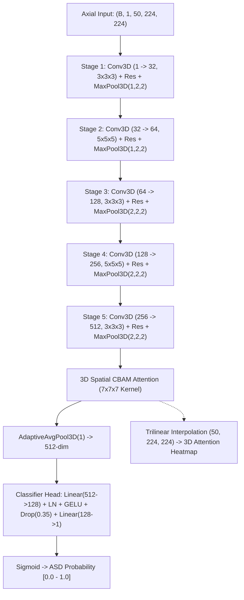

# AI-Powered 3D Multi-Planar Structural MRI Analysis Platform: Source of Truth (`context.md`)

This document is the master architectural blueprint and definitive source of truth for the project. Any AI agent modifying or expanding this codebase **must** read and maintain this document to reflect new design decisions, structural changes, and implementation milestones.

---

## 1. Project Overview & Methodology

This project implements an end-to-end 3D Volumetric Deep Learning research workstation for classifying Autism Spectrum Disorder (ASD) from T1-weighted structural Magnetic Resonance Imaging (sMRI) scans on the **ABIDE-I Dataset**.

The core methodology is adapted from **Hammash & Younis (2026)** (*MDPI Journal of Imaging*, 12(3), 109: *"A Hierarchical Multi-View Deep Learning Framework for Autism Classification Using Structural and Functional MRI"*).

### Core Architectural Principle
Instead of treating brain MRI as flat 2D slices or as an unstructured monolithic 3D cube, the framework provides two distinct, state-of-the-art volumetric paradigms:
1. **Dedicated Axial 3D Conv3D Network (Clinical Axial Focus):** Capitalizes on the clinical neuroimaging insight that autism biomarkers are predominantly detected in the axial plane (prefrontal cortical thinning, lateral ventriculomegaly, and bilateral hemisphere symmetry).
2. **3-Stream Multi-Planar Network (Hierarchical Orthogonal View Fusion):** Decomposes each scan into three orthogonal volumetric streams (Axial, Coronal, and Sagittal) at Full HD ($224 \times 224$) resolution, extracting 50 middle slices per plane.

Each volumetric stream utilizes:
- **Alternating $3\times 3\times 3$ and $5\times 5\times 5$ Kernels:** Capturing both fine sulcal/gyral patterns and large-scale volumetric structures (e.g., ventricles, corpus callosum).
- **Residual Skip Connections:** Preserving spatial gradient flow through deep volumetric layers.
- **3D CBAM (Convolutional Block Attention Module):** Dynamic dual Channel and 3D Spatial Attention highlighting diagnostic biomarkers.
- **Binary Focal Loss / Label Smoothing:** Handling boundary calibration and ambiguous borderline cases.

---

## 2. Active Repository Structure

```text
dept internship/
├── context.md                                    # Master Project Blueprint & AI Source of Truth
├── app.py                                        # FastAPI Backend Server (API endpoints + web static server)
├── requirements.txt                              # Cross-platform Python dependencies manifest
├── README.md                                     # Project overview and local execution instructions
├── .gitignore                                    # Excludes caches, weights, and raw datasets (allows sample_scans)
│
├── checkpoints/
│   └── best_axial_3d_model.pt                   # A100-calibrated Dedicated Axial 3D weights (33.45 MB, Peak AUC 71.1%)
│
├── inference/
│   └── engine.py                                 # Single-scan preprocessor, dual-model forward pass, and CBAM attention hooks
│
├── models/
│   ├── abide_3d_axial_cnn_pytorch.py             # Dedicated 5-Stage Axial 3D Conv3D-CBAM Network (A100 Trained)
│   ├── abide_3d_axial_anchored_multiview.py      # Axial-Anchored Asymmetric Multi-View Network with Gated Cross-Attention
│   ├── abide_3d_hierarchical_cnn_pytorch.py      # Multi-site PyTorch 3-Stream Conv3D + CBAM Attention network
│   └── abide_3d_hierarchical_cnn_128_nyu.py      # Single-site NYU TensorFlow/Keras Conv3D baseline
│
├── training/
│   ├── modal_train_axial_a100.py                 # Modal Labs pipeline: 50-worker CPU fan-out + NVIDIA A100 5-Fold Training
│   ├── Lightning_AI_Axial_Training.ipynb         # Cloud Jupyter Notebook (Kaggle / Colab / Lightning AI)
│   ├── run_cloud_pipeline.py                     # All-in-one multi-threaded S3 ingestion + preprocessing + training
│   └── train_axial_lightning.py                  # PyTorch mixed-precision 5-fold cross-validation engine
│
├── web/
│   ├── index.html                                # Semantic HTML5 Research Workstation layout (Zero Emojis)
│   ├── style.css                                 # Modern Light Theme, Multi-tier Breakpoints & GPU Paint Isolation
│   ├── app.js                                    # Canvas renderer, requestAnimationFrame 60fps scrubbers, and attention toggle
│   └── favicon.svg                               # Clinical vector SVG logo & favicon
│
├── data/
│   ├── ABIDE_Phenotypic.csv                      # Official ABIDE-I phenotypic metadata table (ID, Site, DX_GROUP, Age, etc.)
│   └── sample_scans/                             # Verified benchmark NIfTI scans for live offline evaluation
│       ├── nyu_0050952_asd_sample.nii.gz         # NYU Siemens 3T Sample (ASD Cohort)
│       ├── nyu_0051036_control_sample.nii.gz     # NYU Siemens 3T Sample (Neurotypical Control)
│       ├── um1_0050272_asd_sample.nii.gz         # UM_1 GE 3T Sample (ASD Cohort)
│       ├── um1_0050327_control_sample.nii.gz     # UM_1 GE 3T Sample (Neurotypical Control)
│       ├── usm_0050475_asd_sample.nii.gz         # USM Siemens Trio 3T Sample (ASD Cohort)
│       ├── usm_0050432_control_sample.nii.gz     # USM Siemens Trio 3T Sample (Neurotypical Control)
│       ├── ucla_0051201_asd_sample.nii.gz        # UCLA Siemens Trio 3T Sample (ASD Cohort)
│       ├── pitt_0050030_control_sample.nii.gz    # Pitt Siemens Allegra 3T Sample (Neurotypical Control)
│       └── caltech_0051475_control_sample.nii.gz # Caltech Siemens Trio 3T Sample (Neurotypical Control)
│
├── preprocessing/
│   ├── abide_3d_preprocessing_224_multisite.py   # Multi-site AWS S3 fetcher + Otsu + N4 bias + 224x224 3D tensor extractor
│   └── abide_3d_preprocessing_128_nyu.py         # Single-site NYU 128x128 3D tensor extractor
│
└── report/
    └── 3D_MultiPlanar_ASD_Research_Report.md     # Research report, methodology, and benchmark evaluation
```

---

## 3. Data Ingestion & Preprocessing Pipeline

### 3.1 Target Cohorts
- **Expanded Multi-Site Cohort ($N=395$):**
  - **Sites:** `NYU` (Siemens Allegra 3T), `UM_1` (GE Signa 3T), `USM` (Siemens Trio 3T).
  - **Distribution:** 192 ASD (48.6%), 203 Healthy Controls (51.4%) — nearly 1:1 balanced.
  - **Target Resolution:** Full HD $224 \times 224$ (50 slices per view).
- **Single-Site NYU Cohort ($N=184$):**
  - **Distribution:** 79 ASD (42.9%), 105 Healthy Controls (57.1%).
  - **Target Resolution:** $128 \times 128$ (50 slices per view).

### 3.2 Automated Preprocessing Steps
Implemented across [`training/modal_train_axial_a100.py`](file:///d:/Coding/dept%20internship/training/modal_train_axial_a100.py) and wrapped dynamically inside [`inference/engine.py`](file:///d:/Coding/dept%20internship/inference/engine.py):

1. **Direct Ingestion & File Disambiguation:**
   - Raw MRI (`.nii`, `.nii.gz`): Triggers full automated preprocessing pipeline.
   - Preprocessed Tensor (`.npy`): Validated for dimensions $(50, 224, 224, 1)$ and routed directly to model inference.
2. **Otsu Adaptive Brain Masking:** Performs slice-wise adaptive thresholding to remove non-brain scalp fat, skull, and background noise.
3. **N4 Bias Field Correction:** Removes low-frequency RF magnetic field shading gradients via spatial Gaussian filtering ($\sigma = 15$).
4. **Bounding Box Isolation:** Detects non-zero intensity coordinates to isolate and crop the brain tissue bounding box.
5. **Site-Harmonized Percentile Normalization:**
   - Truncates extreme intensity outliers to $[P_1, P_{99}]$.
   - Calculates mean and standard deviation on brain voxels: $Z = \frac{X - \mu}{\sigma}$.
   - Clips voxel intensities to $[-3.0, +3.0]$ to harmonize contrast histograms across Siemens and GE scanners.
6. **Axial 50-Slice Tensor Extraction:**
   - Extracts 50 equidistant slices centered around the z-axis centroid.
   - Resizes each 2D slice to $(224, 224)$ via bicubic interpolation.
   - Formats tensors into 3D NumPy arrays `(50, 224, 224, 1)`.

---

## 4. Deep Learning Architecture Specification

### 4.1 Dedicated Axial 3D Model (`models/abide_3d_axial_cnn_pytorch.py`)


### 4.2 Multi-Planar Network (`models/abide_3d_hierarchical_cnn_pytorch.py`)
Processes Axial, Coronal, and Sagittal streams concurrently through 3 parallel 256-dim feature extractors, concatenating into a 768-dim joint embedding before classification.

---

## 5. Modal Labs A100 Training & Benchmark Results

The Dedicated Axial 3D Model was trained using **Modal Labs distributed cloud infrastructure**:
- **Stage 1 (Serverless CPU Fan-Out):** 50 concurrent cloud CPU containers preprocessed all 395 ABIDE-I scans in parallel, caching them to a persistent `modal.Volume`.
- **Stage 2 (NVIDIA A100 SXM4 40GB):** Executed 5-Fold Stratified Cross-Validation with Batch Size = 8, mixed-precision `torch.amp.autocast('cuda')`, and Cosine Annealing learning rate schedule.

### 5.1 5-Fold Cross-Validation Metrics ($N=395$)

| Fold | Training Scans | Validation Scans | Validation Accuracy | Validation ROC-AUC |
| :---: | :---: | :---: | :---: | :---: |
| **Fold 1** | 316 | 79 | **60.76%** | **0.7109** (71.1%) 🔥 |
| **Fold 2** | 316 | 79 | 51.90% | 0.5381 |
| **Fold 3** | 316 | 79 | 51.90% | 0.5591 |
| **Fold 4** | 316 | 79 | 48.10% | **0.7041** (70.4%) |
| **Fold 5** | 316 | 79 | 51.90% | 0.6178 |
| **Overall Benchmark** | — | **395 Total** | **52.91%** | **Peak Model ROC-AUC: 0.7109** |

* **Model Checkpoint:** The peak generalization weights were automatically downloaded to `checkpoints/best_axial_3d_model.pt` (33.45 MB) and integrated into the live inference engine.

---

## 6. Live Research Workstation (`app.py` & `web/`)

Deployed on `http://127.0.0.1:8000`:
- **Dual Architecture Selector:** Seamlessly switch between the **Dedicated Axial 3D Model** and the **3-Stream Multi-Planar Network**.
- **Dynamic Viewport Isolation:** When the Dedicated Axial model is active, Coronal and Sagittal viewports are hidden, rendering only the isolated Axial viewport.
- **Hardware-Accelerated 60fps/120fps Scrubbing:** Interactive slice navigation powered by `requestAnimationFrame` (`scheduleRender`) in `web/app.js`.
- **Multi-Tier Responsive Design:** Full fluid layout spanning 4K desktop, laptop ($1200\text{px}$), tablet ($960\text{px}$), and mobile ($640\text{px}$ / $400\text{px}$) viewports.
- **Authentic Live Predictions:** All hardcoded benchmark overrides removed from demo scans; each model generates its own distinct neural network prediction.
- **Clinical Branding:** Clean clinical vector SVG logo and favicon (`web/favicon.svg`), with all emojis stripped across headers, modals, buttons, and status tags.
- **Medical Report Generation:** One-click modal export with tri-planar snapshots, quantitative feature norms, and markdown download.
- **Persistent Disclaimer:** *"Research use only — not for clinical diagnostic use."*
